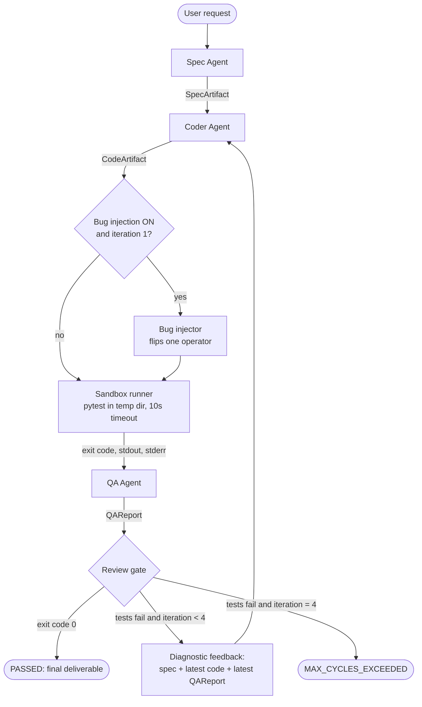

# Multi-Agent Dev Squad

A 3-agent software development squad that writes, tests and repairs Python code in a loop until the tests pass or a hard iteration limit is reached.

- **Product Spec Agent** turns a request into requirements and acceptance criteria.
- **Coder Agent** writes `solution.py` and `test_solution.py`.
- **Reviewer/QA Agent** runs the tests in a sandbox and writes the review. The pass/fail verdict comes from pytest's exit code, never from an AI opinion.

**Live demo:** https://qwhpvjwny8v5wbfhmxep4q.streamlit.app/ (Streamlit Community Cloud; the app sleeps when idle, so the first visit may take a minute to wake up)

**Orchestration framework:** LangGraph (`StateGraph`) · **Max refinement cycles:** 4 · **Python:** 3.11

---

## 1. System architecture and collaboration diagram



The loop always ends: it stops when the tests pass or when `iteration >= max_iterations` (4), whichever comes first.

## 2. Installation and setup

Requires [uv](https://docs.astral.sh/uv/) and Python 3.11+.

```bash
git clone https://github.com/DS-0277/multi-agent-dev-squad.git
cd multi-agent-dev-squad
uv sync                      # creates .venv with Python 3.11 and installs pinned dependencies
cp .env.example .env         # then edit .env and set OPENAI_API_KEY
```

| Variable | Purpose | Default |
|---|---|---|
| `OPENAI_API_KEY` | Your OpenAI key (required) | none |
| `OPENAI_MODEL` | Model used by all three agents | `gpt-4o` |
| `OPENAI_TEMPERATURE` | Randomness; low keeps runs steadier | `0.2` |

`.env` is git-ignored. Never commit a real key.

## 3. Agent and schema specifications

### Repository layout

```
src/
  schemas.py            Pydantic artifacts (the only data agents exchange)
  sandbox.py            Isolated pytest/Python runner
  bug_injector.py       Adversarial first-pass bug injection (demo/testing)
  orchestrator.py       LangGraph loop, iteration ceiling, streaming
  app.py                Streamlit interface
  agents/
    spec_agent.py       Product & Requirements Engineer
    coder_agent.py      Implementation & test generator
    reviewer_agent.py   Auditor & pytest execution evaluator
tests/                  25 tests (sandbox, schemas, orchestration, UI)
```

### Pydantic schemas (`src/schemas.py`)

| Artifact | Fields |
|---|---|
| `SpecArtifact` | `feature_name: str`, `requirements: list[str]`, `test_cases: list[str]`, `interfaces: str` |
| `CodeArtifact` | `implementation_code: str`, `test_code: str`, `iteration: int` |
| `QAReport` | `tests_passed: bool`, `total_tests: int`, `failed_tests: int`, `execution_output: str`, `review_feedback: list[str]`, `status: "PASSED" \| "NEEDS_REVISION" \| "MAX_CYCLES_EXCEEDED"` |

Invalid data (missing fields, wrong types, unknown status values) is rejected at the boundary.

### Least-privilege context passing

Agents never receive a cumulative chat history. Each agent gets only the typed artifacts it needs:

| Agent | Receives | Returns |
|---|---|---|
| Spec Agent | The user request | `SpecArtifact` |
| Coder Agent, iteration 1 | `SpecArtifact` | `CodeArtifact` |
| Coder Agent, iteration 2+ | `SpecArtifact`, its **latest** `CodeArtifact`, the **latest** `QAReport` | `CodeArtifact` |
| QA Agent | The latest `CodeArtifact` | `QAReport` |

Older iterations are discarded, so context size stays flat however many cycles run.

### Deterministic verdict

`tests_passed = (exit_code == 0 and not timed_out)`, computed from the real pytest subprocess. The QA Agent's LLM only contributes `review_feedback` (critique notes) and cannot change the verdict.

## 4. Sandbox security boundaries

AI-generated code is untrusted. `src/sandbox.py` applies these controls:

| Control | How |
|---|---|
| No shell injection | `subprocess.run([...], shell=False)` with an argument list, never a command string |
| Isolated working directory | Code is written to a `tempfile.TemporaryDirectory`, deleted afterwards |
| Execution timeout | 10 seconds; the child process is killed on expiry (`SandboxTimeoutError`, reported as a `timed_out` result by `run_tests`) |
| No secrets in the child process | `env=SAFE_ENV` passes only `PATH` and `PYTHONDONTWRITEBYTECODE`; `OPENAI_API_KEY` is never inherited |
| Output capture | stdout, stderr and exit code are captured, not streamed to the host |

**What this does not do (honest limits):** the sandbox is process isolation, not a full jail. Generated code could still read ordinary files the server user can access or make network calls, and there are no CPU or memory limits. Stronger isolation would need containers (Docker, E2B) or OS-level limits. Only run it with an API key whose spend is capped; the public demo also limits each session to 5 runs as a cost guard.

## 5. Execution commands

```bash
uv run streamlit run src/app.py     # start the web UI at http://localhost:8501
uv run pytest -v                    # run the full test suite (about 30 seconds, no API calls)
```

**Using the UI:** pick or write a request, optionally switch on **Adversarial bug injection** (breaks the Coder's first pass so you can watch QA catch it and the Coder self-correct), then click **Run squad**. The Spec Board, Coder Terminal and QA Test Runner Console tabs update live, with an iteration badge and a status light: 🟡 IN PROGRESS, 🟢 CONVERGED (ALL TESTS PASS), 🔴 TERMINATED (MAX CYCLES).

**Tests (25):** sandbox pass/fail/timeout, key isolation, schema validation, clean convergence on iteration 1, termination at exactly 4 iterations, bug injector behavior, run-limit and temperature checks. All agent and LLM calls are mocked, so the suite is free.

**Deployment (Streamlit Community Cloud):** create an app from this repo with main file `src/app.py` and Python 3.11, and add `OPENAI_API_KEY = "sk-..."` under the app's Secrets. The app reads it from `st.secrets`.

## 6. AI audit log summary

Full details, with before and after code, are in [ai_prompt_log.md](ai_prompt_log.md). The baseline was generated from the assignment's sample prompt with Claude Code and committed unaudited (`6baded5`).

| Audit area | Result | Finding |
|---|---|---|
| Arbitrary code execution | **Defect found, fixed** | No `shell=True`, but the child process inherited the full environment, so generated code could read `OPENAI_API_KEY`. Fixed with `env=SAFE_ENV`. |
| Context bloat | Good, no defect | The Coder already received only spec, latest code and latest report. An unused `history` list was removed. |
| Sycophancy trap | **Defect found, fixed** | `tests_passed` came from the LLM's answer, so a lying LLM could approve a failing build. Now derived from the pytest exit code. |
| Infinite refinement loops | Good, no defect | The loop stops at 4 iterations; proven by an automated test. |

Further issues found by running the real system:

- **LLM-written bug injection was unreliable**, so it was replaced by a mechanical operator flip that is kept only if the tests then fail, and only injected into code that passes its own tests first.
- **The Coder rewrote whole solutions and caused deadlocks** on repair; its prompt now requires minimal fixes.
- **Timeouts gave the Coder no useful feedback**; the message now explains the 10s limit.
- **Flaky AI-written tests** caused inconsistent runs; lowering temperature to 0.2 steadied them.

**Known limitations:** LLM output varies between runs, so a run can occasionally need more cycles or end 🔴 at the 4-cycle limit (the circuit breaker working as designed). Simpler requests such as the LRU Cache are more reliable than timing-heavy ones such as the Token Bucket.
